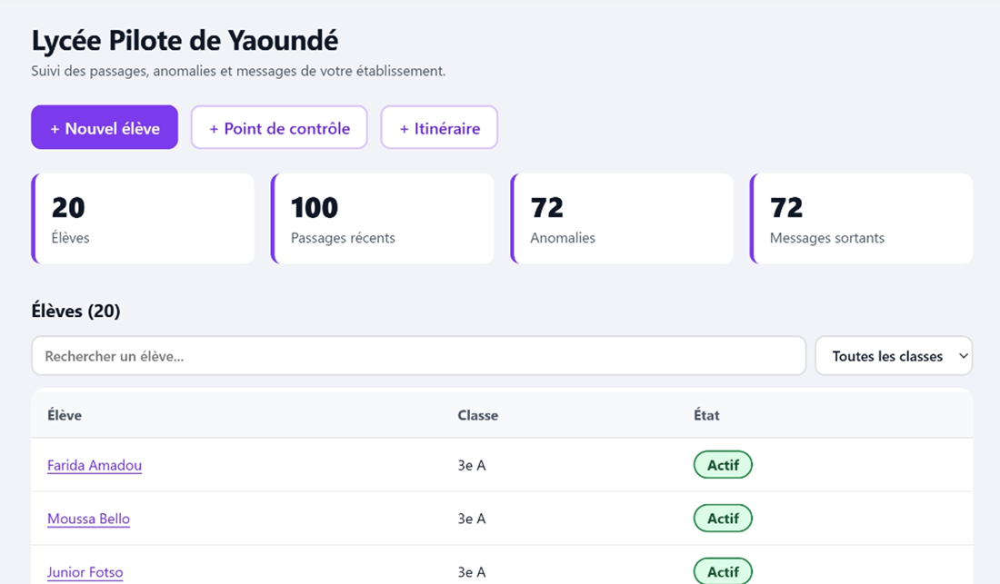
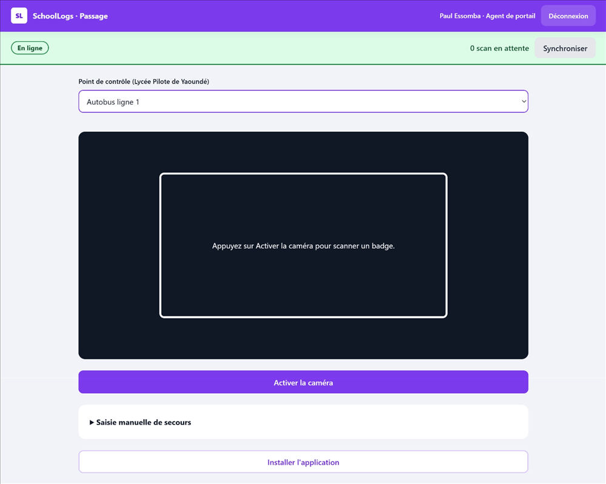
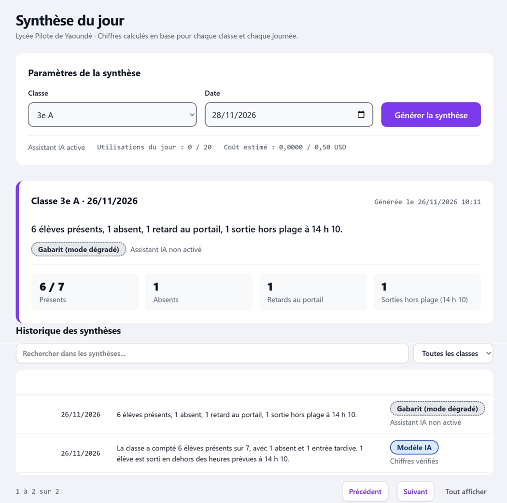

# SchoolLogs : Module « Passage »

Module de suivi des passages d'élèves aux points de contrôle d'un établissement scolaire (portail d'entrée, portail de sortie, autobus), conçu pour fonctionner en **réseau dégradé**, avec **badges numériques rotatifs** résistants à la copie, **détection automatique d'anomalies** et **synthèse quotidienne assistée par IA** encadrée par des garde-fous stricts.

---

## 1. Présentation

Dans un établissement scolaire, le portail ne dispose pas toujours d'une connexion fiable, l'horloge d'un appareil de scan peut être déréglée et un badge statique photographié pourrait être réutilisé par un tiers. Le module **Passage** organise le suivi autour de trois rôles contrôlés côté serveur :

- **Agent de portail** : scanne les badges depuis un écran unique utilisable hors ligne et synchronise sa file locale au retour du réseau.
- **Responsable** : gère les élèves, parents, badges, points de contrôle et itinéraires de son établissement ; consulte les passages, anomalies, messages sortants, synthèses du jour et journal d'audit.
- **Parent** : consulte exclusivement les passages et anomalies de ses propres enfants.

### Vidéos (démonstration technique et capsule de communication)

Les deux vidéos demandées (démonstration technique des 7 scénarios + capsule de communication destinée à un chef d'établissement) sont accessibles sans demande d'autorisation sur Google Drive :
https://drive.google.com/drive/folders/1ol2bYfbkmup0FBtDAZKNUEc5p87Zs-cB?usp=sharing

### Aperçus de l'application

| Tableau de bord Responsable | Écran de scan Agent (PWA hors ligne) |
|---|---|
|  |  |

| Synthèse quotidienne (modèle IA et mode dégradé par gabarit) |
|---|
|  |

---

## 2. Technologies et justification

| Composant | Choix retenu | Justification |
|---|---|---|
| **Backend** | Python 3.12 + **Django 5.2 LTS** | Support long terme jusqu'en avril 2028 ; fournit nativement l'ORM paramétré, les migrations, les sessions serveur, l'échappement XSS et la protection CSRF. |
| **Base de données** | **SQLite** par défaut (mode **WAL**, `transaction_mode=IMMEDIATE`, `timeout=20 s`) ; PostgreSQL optionnel via `.env` | Zéro service externe à installer pour lancer le projet localement, tout en gérant la concurrence entre serveur web et planificateur. |
| **Mots de passe** | **Argon2id** (`argon2-cffi`) | Hachage moderne résistant aux attaques par force brute, configuré en premier dans `PASSWORD_HASHERS`. |
| **Interface et PWA** | Gabarits Django + CSS/JS natifs, **PWA unique** (écran de scan et page « Mon badge »), bibliothèques QR locales | Zéro dépendance Node ni étape de build ; fonctionne hors ligne sans CDN ni police distante. |
| **Planificateur** | Commande Django exécutée en boucle (sans Celery ni Redis) | Détection d'absence autonome et idempotente sans infrastructure tierce. |
| **Lancement** | Commandes locales directes (sans Docker) | Docker n'étant pas disponible sur le poste de développement, aucun fichier Docker non testé n'est inclus. |

### Organisation du code

Séparation en trois couches dans `passage/` (identifiants de code en anglais, interface, documentation et commits en français) :

```text
schoollogs-passage/
├── config/                  # Paramétrage Django, routage racine, WSGI/ASGI
├── passage/
│   ├── models/              # Modèles ORM (7 modules) et contraintes d'intégrité BD
│   ├── migrations/          # Migrations SQL reproductibles
│   ├── repositories/        # Requêtes ORM cloisonnées (parent et établissement)
│   ├── services/            # Logique métier (auth, audit, badges rotatifs, horloge, synchro, anomalies, notifications, synthèse IA, gateways)
│   ├── forms/ & views/      # Validation serveur, contrôle des rôles, vues HTML/JSON
│   ├── admin.py             # Interface « Gestion des fiches » réservée au Responsable et cloisonnée
│   ├── templates/ & static/ # Interface sobre alignée SchoolLogs (CSS/JS natifs, PWA installable)
│   ├── management/commands/ # Script de peuplement rejouable (seed_demo) et planificateur autonome (run_scheduler)
│   └── tests/               # Tests smoke + tests boîte noire sur les points critiques
├── .github/workflows/ci.yml # Intégration continue GitHub Actions
├── .env.example             # Gabarit de configuration sans secret réel
├── DECISIONS.md             # Choix d'architecture et adaptations du modèle
└── JOURNAL-IA.md            # Suivi quotidien de l'usage des outils d'IA
```

---

## 3. Installation et lancement

### Prérequis
- Python **3.10 à 3.14** (développé et testé avec Python **3.12**).

### Windows (PowerShell)

```powershell
python -m venv .venv
.\.venv\Scripts\Activate.ps1
pip install -r requirements.txt
Copy-Item .env.example .env
python manage.py migrate
python manage.py seed_demo
python manage.py runserver
```

### Linux / macOS

```bash
python3 -m venv .venv
source .venv/bin/activate
pip install -r requirements.txt
cp .env.example .env
python manage.py migrate
python manage.py seed_demo
python manage.py runserver
```

Ouvrir ensuite **http://localhost:8000**. Dans un second terminal (avec le même environnement virtuel), lancer le planificateur autonome : `python manage.py run_scheduler` (ou `python manage.py run_scheduler --once` pour un seul cycle). La commande `python manage.py seed_demo` est rejouable : l'exécuter plusieurs fois ne crée aucun doublon.

### Configuration (`.env`)

Les seuils, durées et plafonds sont configurables via [.env.example](.env.example) :
- `SECRET_KEY` : obligatoire et unique hors `DEBUG=1` (l'application refuse de démarrer si la valeur d'exemple est conservée avec `DEBUG=0`).
- `DEBUG` : `1` en développement local uniquement ; `0` par défaut si omis.
- `CLE_API_IA` : vide par défaut (active automatiquement le mode dégradé par gabarit).
- `DEMO_MODE` : `0` (désactivé) par défaut ; le banc de démonstration multi-badges (`/responsable/demo/`) n'est **jamais actif en configuration par défaut** (`404`). En définissant `DEMO_MODE=1` uniquement lors d'une démonstration, le Responsable peut afficher jusqu'à 20 codes QR rotatifs signés côté serveur (sans secret ni nom d'élève) ; l'option `python manage.py seed_demo --demo-20` peut aussi ajouter 20 élèves de démonstration supplémentaires.
- `DB_ENGINE` : `sqlite` par défaut ; bascule possible vers `postgresql` (requiert `psycopg` et les variables `DB_*`).

### Contexte sécurisé du navigateur (caméra et PWA installable)

L'application est une **PWA installable** (manifeste `/manifest.webmanifest`, icônes PNG `180/192/512`, balises iOS, Service Worker `/sw.js` et bouton d'installation). Les API navigateur **caméra** et **Service Worker** nécessitent HTTPS ou `http://localhost`. En démonstration locale, l'écran de scan tourne sur `http://localhost:8000` (PC, avec Service Worker, installation et caméra actifs). L'activation et l'affichage sur téléphone connecté au même Wi-Fi fonctionnent via `python manage.py runserver 0.0.0.0:8000` (en ajoutant l'adresse IP locale du PC dans `ALLOWED_HOSTS` et `CSRF_TRUSTED_ORIGINS` du `.env`) ; la caméra navigateur et la réouverture hors ligne sur téléphone exigent toutefois HTTPS (hors périmètre local).

---

## 4. Comptes de test

Créés de façon reproductible par `python manage.py seed_demo` (**20 élèves** sur 3 classes `3e A`, `4e B`, `Tle D`, **6 parents**, 3 points de contrôle, 5 jours ouvrés de passages, anomalies et messages sortants ; mots de passe de démonstration uniquement, jamais réutilisés ailleurs) :

| Rôle | Identifiant | Mot de passe | Accès |
|---|---|---|---|
| **Responsable** | `responsable` | `DemoResp!2026` | `/responsable/`, `/responsable/badges/`, `/responsable/synthese/`, `/responsable/audit/`, `/admin/` |
| **Agent de portail** | `agent` | `DemoAgent!2026` | `/scan/` uniquement |
| **Parent 1** (3 enfants : Amina, Samuel, Inès) | `parent1` | `DemoParent1!2026` | `/parent/` |
| **Parent 2** (4 enfants : Clarisse, Junior, Diane, Olivier) | `parent2` | `DemoParent2!2026` | `/parent/` |

*(Quatre autres comptes parents `parent3` à `parent6`, mots de passe `DemoParent3!2026` à `DemoParent6!2026`, couvrent les autres élèves du jeu de démonstration.)*

---

## 5. Tests et intégration continue

```bash
python manage.py check
python manage.py test --verbosity=2
```

La suite comprend **230 tests** :
- **7 tests de socle** (configuration, WAL SQLite, Argon2id, route de santé, `DEMO_MODE=0` par défaut).
- **62 tests boîte noire** sur l'authentification, le blocage temporaire, l'expiration de session, le cloisonnement parent et multi-établissements, le CSRF, l'anti-XSS, les contraintes BD et le peuplement.
- **32 tests boîte noire** sur le cycle de vie des badges, les liens d'activation à usage unique, les codes rotatifs signés HMAC-SHA256, l'anti-rejeu, l'idempotence de synchronisation sur 20 badges, la reprise après interruption et la correction/signalement d'horloge (2 h d'écart et horloge aberrante).
- **29 tests boîte noire** sur la détection automatique des 5 anomalies, le planificateur autonome idempotent (`run_scheduler`), la résolution automatique après synchronisation tardive et le traitement responsable cloisonné.
- **100 tests boîte noire** sur les notifications sortantes isolées derrière une interface fournisseur, le plafond journalier (`PLAFOND_MESSAGES`), la synthèse assistée par IA et ses 4 garde-fous (sortie JSON contrainte avec au plus 1 relance, mode dégradé sans clé ou en panne, journalisation/plafonds de coût et cache par empreinte, fidélité numérique exacte comparée à la base et zéro donnée personnelle transmise au modèle).

Elle est exécutée automatiquement à chaque envoi via [.github/workflows/ci.yml](.github/workflows/ci.yml) avec `DEBUG=0`, `CLE_API_IA=""`, `DEMO_MODE=0` et contrôle d'absence de fichier `.env` versionné.

---

## 6. Sécurité

| Axe | Mesure en place / prévue | État |
|---|---|---|
| **Mots de passe** | Hachage Argon2id, longueur minimale 8 caractères, jamais stockés en clair ni dans l'audit. | En place et testé |
| **Anti-force brute et énumération** | Blocage temporaire par couple `(identifiant, IP)` (5 échecs / 15 min), message d'erreur strictement identique et égalisation du temps de réponse. | En place et testé |
| **Sessions** | Sessions serveur bornées à 8 h, cookie `HttpOnly` + `SameSite=Lax`, déconnexion en `POST` détruisant la session en base. | En place et testé |
| **Contrôle des rôles** | Vérification serveur sur chaque vue (HTML et API JSON `401`/`403`) ; Agent cantonné à `/scan/`, « Gestion des fiches » (`/admin/`) réservée au Responsable. | En place et testé |
| **Cloisonnement (anti-IDOR)** | Accès parent filtré à ses propres enfants et accès responsable filtré à son seul établissement ; refus uniforme `403` + trace dans `AuditLog`. | En place et testé |
| **Validation, CSRF et anti-XSS** | Validation serveur systématique, ORM exclusif, `CsrfViewMiddleware` actif sur toutes les écritures (y compris `/api/sync/` et l'activation), échappement automatique des gabarits, en-têtes `nosniff` et `X-Frame-Options: DENY`. | En place et testé |
| **Gestion des secrets** | Aucun secret dans le dépôt ; `.env` ignoré dès le premier commit, garde CI anti-`.env`, `Badge.secret` masqué partout (livré une seule fois au support lors de l'activation) et jetons d'activation stockés uniquement sous forme de hachage SHA-256. | En place et testé |
| **Badges résistants à la copie** | Code QR rotatif signé HMAC-SHA256 (`v1.<id_opaque>.<pas>.<sig>`), pas de 30 s, tolérance ±1 pas, usage unique en base sur `(badge, pas)`, secret jamais transmis à l'appareil de scan. *Limite assumée :* une copie présentée dans la même fenêtre avant le vrai scan ne peut pas être distinguée ; la courte durée et l'usage unique limitent cette fenêtre. | En place et testé |
| **Garde-fous IA et vie privée** | Aucun nom d'élève ni donnée parent transmis au modèle externe (uniquement des compteurs agrégés calculés en base) ; sortie JSON validée avec contrôle de fidélité numérique, au plus 1 relance, journalisation et plafonds quotidiens d'appels et de coût. | En place et testé |

### Ce qui serait ajouté avec davantage de temps
- Déploiement **HTTPS/TLS** complet (cookies `Secure`, HSTS) permettant aussi le hors ligne sur téléphone.
- Enregistrement et attestation des appareils de scan.
- Chiffrement au repos des secrets de badge avec rotation périodique.
- Journalisation détaillée des consultations nominatives.

---

## 7. Mode dégradé

1. **Scan hors ligne et « Mon badge »** : la PWA installable met en cache les ressources locales (bibliothèques QR `jsQR` et `qrcode.js` embarquées sans CDN), conserve les points de contrôle et la file de scans dans `localStorage` même après fermeture d'onglet ou expiration de session (`401`), affiche uniquement un retour neutre « Scan enregistré » hors ligne (et un bandeau rouge immédiat si un rejet revient en ligne du serveur), puis synchronise sans perte ni doublon au retour du réseau. Côté support, « Mon badge » génère son QR rotatif localement sans réseau après activation et recalage d'horloge via `/api/time/`.
2. **Synthèse du jour sans IA disponible** : si `CLE_API_IA` est vide, si le service externe répond en erreur ou hors délai, si la sortie reste non conforme après une unique relance ou si un plafond journalier (appels ou coût) est atteint, la synthèse est produite automatiquement à partir d'un gabarit déterministe utilisant exactement les chiffres calculés en base. Le chemin effectivement emprunté (`generation_path`) est enregistré en base, et deux demandes identiques réutilisent le résultat en cache sans nouvel appel facturé.

---

## 8. État d'avancement et ce qui n'est pas terminé

*Point au 28 novembre 2026.*

### Fait et fonctionnel
- Socle Django 5.2 LTS, SQLite WAL + `IMMEDIATE` + timeout de verrou, Argon2id, fuseau `Africa/Douala` (stockage UTC), CI GitHub Actions.
- Modèle de données complet (16 modèles, migration initiale reproductible et contraintes d'intégrité imposées en base).
- Script de peuplement rejouable (`seed_demo`) créant 1 établissement, 8 comptes (1 responsable, 1 agent, 6 parents), 20 élèves sur 3 classes, 3 points de contrôle, itinéraires hebdomadaires, 20 badges actifs et 5 jours ouvrés de passages, anomalies et messages sortants.
- Authentification complète (Argon2id, blocage temporaire, message uniforme, expiration de session, déconnexion serveur effective) et journal d'audit minimal.
- Contrôle strict des rôles côté serveur, cloisonnement parent et multi-établissements, « Gestion des fiches » (`/admin/`) réservée au Responsable, formulaires validés côté serveur (avec sélecteur d'heure `type="time"` sur les itinéraires).
- **Badges numériques rotatifs et scan hors ligne** : cycle de vie tracé (`actif`, `suspendu`, `perdu`, `révoqué`), réémission atomique, liens d'activation uniques hachés SHA-256, signatures HMAC-SHA256 sur pas de 30 s avec usage unique en base, anomalie `BADGE_NON_ACTIF` sur badge inactif signé, correction et marquage d'horloge suspecte, synchronisation par lot idempotente protégée CSRF, retour immédiat en ligne sur badge rejeté, PWA installable (`/manifest.webmanifest`, `/sw.js`, icônes PNG, balises iOS, `/scan/`, `/mon-badge/`) avec bibliothèques QR locales sans CDN.
- **Détection des anomalies et planificateur autonome** : détection des 5 types (`POINT_MANQUANT`, `HORS_FENETRE`, `POINT_INCONNU`, `DOUBLE_SCAN`, `BADGE_NON_ACTIF`), commande en boucle idempotente `run_scheduler`, résolution automatique sur synchronisation tardive, traitement responsable et affichage des itinéraires.
- **Notifications sortantes aux parents** : table de messages sortants isolée derrière une interface fournisseur (`NotificationGateway`), texte neutre sans donnée sensible, déduplication `(anomalie, parent)` et plafond journalier configurable (`PLAFOND_MESSAGES`) traçant explicitement les non-envois.
- **Synthèse quotidienne assistée par IA** : calcul 100 % en base sans nom d'élève envoyé au modèle (`GeminiLLMGateway`), validation stricte du schéma et de la fidélité numérique avec au plus 1 relance, bascule automatique sur gabarit exact en mode dégradé, traçabilité et plafonds quotidiens d'appels/coût (`ModelCallLog`) et cache anti-double facturation.
- **Ergonomie et banc de démonstration** : interface sobre mobile-first alignée SchoolLogs (navigation fixe, menu mobile, filtres de recherche et pagination sur les tableaux, zéro CDN) et banc `/responsable/demo/` strictement désactivé par défaut (`DEMO_MODE=0`).
- **230 tests automatisés au vert** (7 socle + 223 boîte noire), exécutés en CI GitHub Actions.
- **Production vidéo** : démonstration technique des 7 scénarios et capsule de communication disponibles sur le lien Drive ci-dessus.

### Ce qui n'est pas terminé (limites assumées)
- **Exceptions calendaires** (jours fériés, absences justifiées, sorties anticipées) : non implémentées dans ce périmètre pour prioriser la robustesse de la sécurité, du mode hors ligne, de la détection d'anomalies et des garde-fous IA.
- **Messages de rectification automatique** au parent lorsqu'une anomalie `POINT_MANQUANT` est résolue tardivement : l'anomalie passe automatiquement à `Résolue automatiquement` en base, sans émission d'un second message sortant.
- **Tests dédiés au banc de démonstration** : la désactivation par défaut (`DEMO_MODE=0`) est couverte dans les tests de socle en CI ; les 223 tests boîte noire se concentrent sur les fonctionnalités cœur métier.

### Volontairement hors périmètre
- Envoi réel de SMS (isolé derrière `NotificationGateway` et simulé en base).
- Hébergement de production, nom de domaine et HTTPS.
- Carte NFC physique réelle (simulée par la page « Mon badge »).
- Entraînement d'un modèle d'IA propre.
- Journal détaillé de toutes les consultations nominatives (seuls les événements de sécurité critiques et générations de synthèses sont journalisés dans `AuditLog`).
